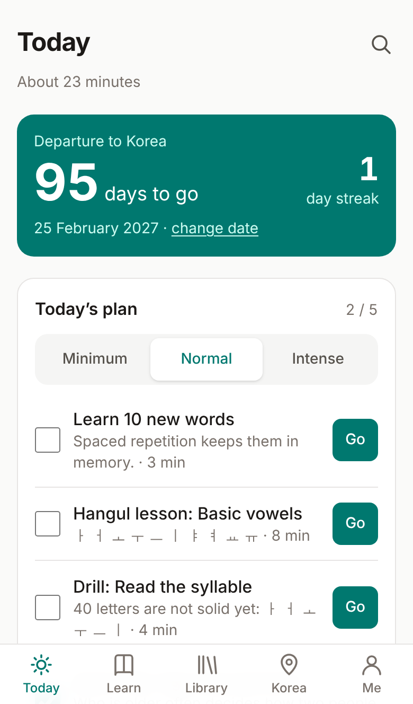
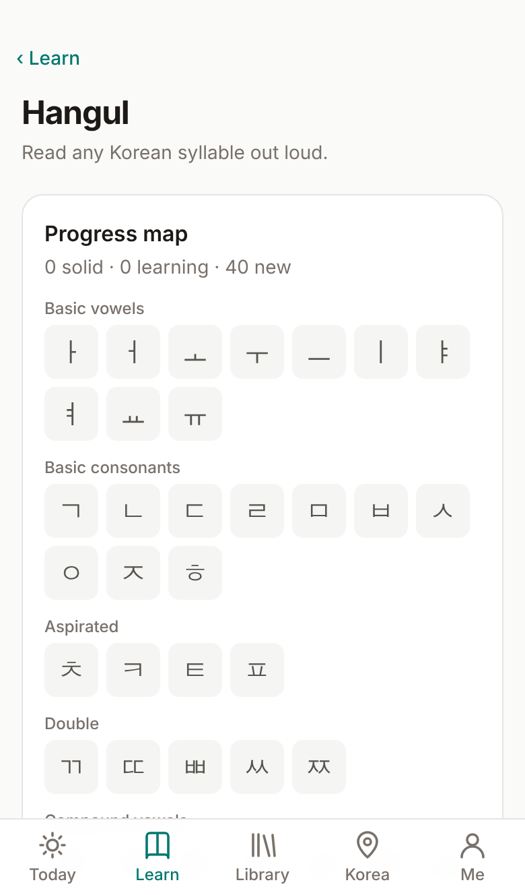
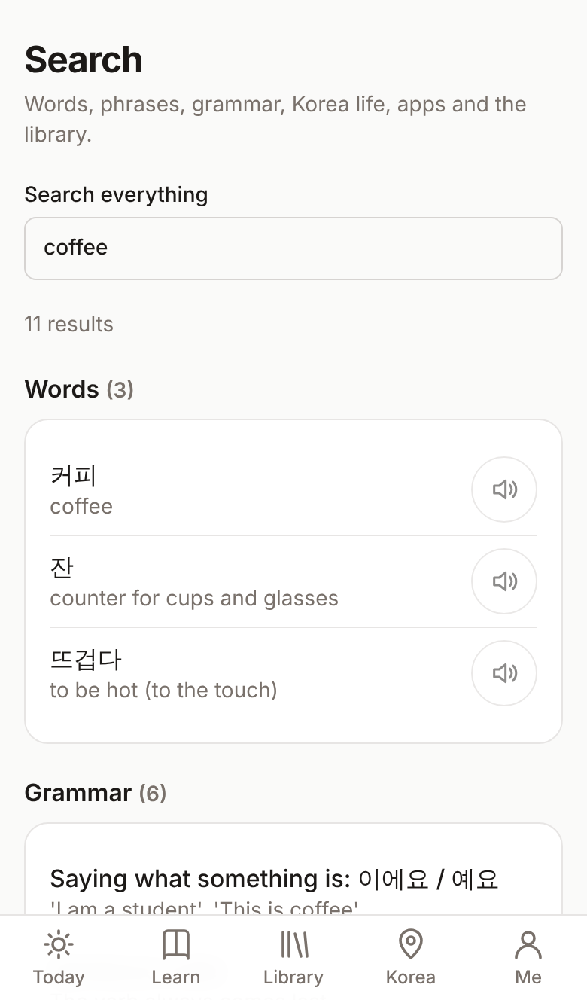
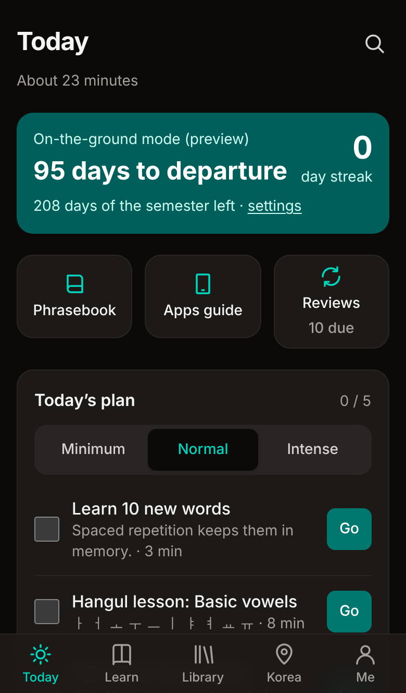

# Hangeul Road

A personal Korean-learning app for one exchange semester: from zero Korean in November to
landing in Ulsan, South Korea, in February. It teaches the alphabet properly, drills
everyday vocabulary with spaced repetition, plans a short study day, and explains how life
in Korea works, from bowing to the apps you cannot live without there.

**Live app:** https://78ahybis.github.io/hangeul-road/ (install it from the browser; it works
offline)

<p>
  
  
  
  
</p>

## Why I built it

I use Duolingo, but it moves past the alphabet too fast, its vocabulary is not what I need
in a dorm, a cafeteria or a bank, and it says almost nothing about Korean culture. I wanted
one home base, built around a realistic goal for 14 weeks: read Hangul fluently, know
600 to 800 useful words, get through everyday situations politely, and arrive with every
essential Korean app set up.

## Features

- **Today:** at most five tasks a day (reviews, one lesson, one drill, one culture card, one
  outside-course task), generated from a 14-week roadmap and my progress. Three day sizes,
  from a 5-minute minimum day. A forgiving streak with a free rest day each week and no guilt
  messages.
- **Hangul:** 40 letters in five lessons, stroke order, a syllable block builder, seven
  sound-change rules, six kinds of drills, timed reading, typing on the Korean two-set
  keyboard, and a progress map per letter.
- **Vocabulary:** 777 words in 17 themed decks with polite example sentences, a spaced
  repetition engine (SM-2 style) with a daily review cap, four card types, a number trainer
  (prices, times, dates, phone numbers) and a deck for my own words.
- **Grammar and phrases:** 21 short grammar lessons with four practice types, 14 situation
  packs (149 phrases) with dialogues and quizzes, a self-introduction builder that picks the
  right particles, and a large-text phrasebook to show someone.
- **Korea life:** 56 culture cards in 12 topics with quizzes, an Ulsan and UNIST section with
  official sources, and a guide to 30 Korean apps: what each needs (Korean number, residence
  card, foreign card), three arrival checklists, "How do I…" answers and the Korean words on
  app buttons.
- **Library:** 37 verified outside resources with filters, a short "Start here" list, a
  recommended path per stage, and active-course tracking that feeds the Today page.
- **Search** across words, phrases, grammar, culture cards, apps, answers and resources.
- **On-the-ground mode:** after arrival, Today shows days in Korea and the semester, with
  the phrasebook, apps guide and reviews one tap away.
- **Installable and offline:** a service worker caches the whole app on first visit. Home
  screen icon, splash screen, an optional daily reminder, a Korean voice picker, text size,
  light and dark mode.
- **Private:** no account, no server, no tracking. Progress lives in IndexedDB on the
  device; a backup file can be shared to Drive, Files or Telegram and imported on a new phone.

## Tech stack

| Area    | Choice                                                              |
| ------- | ------------------------------------------------------------------- |
| UI      | React 19, TypeScript (strict), Tailwind CSS v4                      |
| Build   | Vite, with route-level code splitting (`React.lazy`)                |
| Routing | React Router, `HashRouter` (GitHub Pages has no SPA fallback)       |
| State   | Zustand, persisted by hand to IndexedDB through Dexie               |
| Offline | A small hand-written service worker, generated at build time        |
| Audio   | Web Speech API with the device's Korean voices                      |
| Quality | Vitest (312 tests), ESLint, Prettier, a content validator, axe-core |
| Deploy  | GitHub Actions to GitHub Pages                                      |

Some design decisions worth a look:

- **Content is data.** All learning content is JSON under `src/content/`, checked by
  `npm run validate:content` (required fields, unique ids, Hangul present, polite endings,
  broken references, verified links with dates).
- **Pure logic, tested.** Scheduling, the daily plan, streak rules, search and particle
  choice live in plain functions with unit tests (`src/lib`, `*.test.ts`); React components
  stay thin.
- **One storage table, versioned.** Each feature owns one key in an IndexedDB key-value
  table, so backup and restore cover new features automatically. Anything read from storage
  or a file is sanitized first, so bad data falls back to defaults instead of crashing.
- **Offline without a framework.** `scripts/sw-plugin.ts` lists every built file and writes
  `sw.js` with a content hash; a new version waits until the user taps Reload.

## Run it locally

```bash
npm ci
npm run dev
```

Other commands: `npm test`, `npm run lint`, `npm run validate:content`, `npm run build`.
`CLAUDE.md` describes the code conventions and content schemas; `PROGRESS.md` records what
was built, the decisions made and what still needs checking.

## Honest limits

- Audio uses the voices on the device, so quality depends on the phone (the Me page explains
  how to download a better Korean voice).
- The Korean content was written carefully from standard textbook forms, but has not yet been
  checked by a native speaker. `PROGRESS.md` lists what to check.
- Rules for foreigners using Korean apps changed a lot in 2026; every app entry has a
  `lastVerified` date and says where sources disagree.
